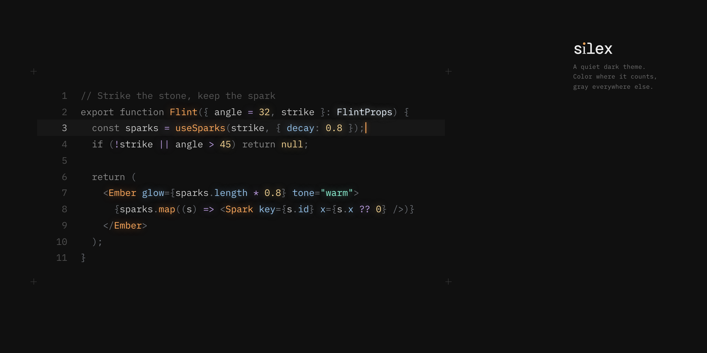

# Silex

Available for [VS Code](https://marketplace.visualstudio.com/items?itemName=cagndz.silex) and [Cursor, VSCodium and Windsurf](https://open-vsx.org/extension/cagndz/silex).

## Development

Colors are defined in `src/palette.ts`. Run `pnpm build` to regenerate the Zed and VS Code themes.

## Credits

Inspired by [Vesper](https://github.com/raunofreiberg/vesper) by Rauno Freiberg and [Ayu](https://github.com/ayu-theme).

## License

MIT
